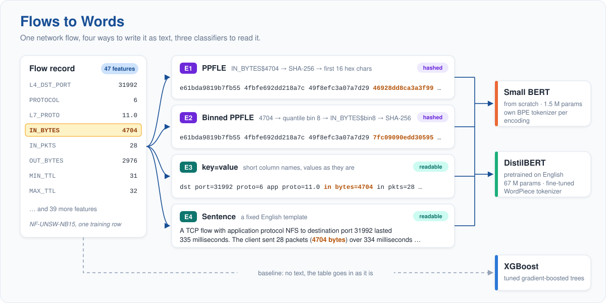
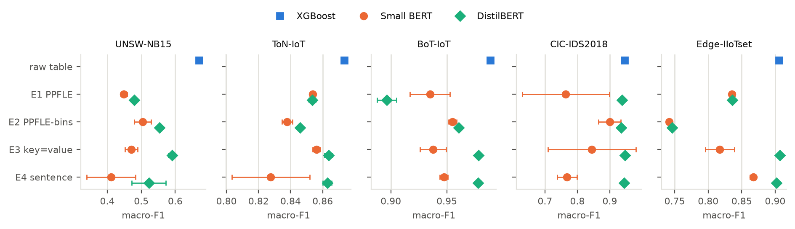
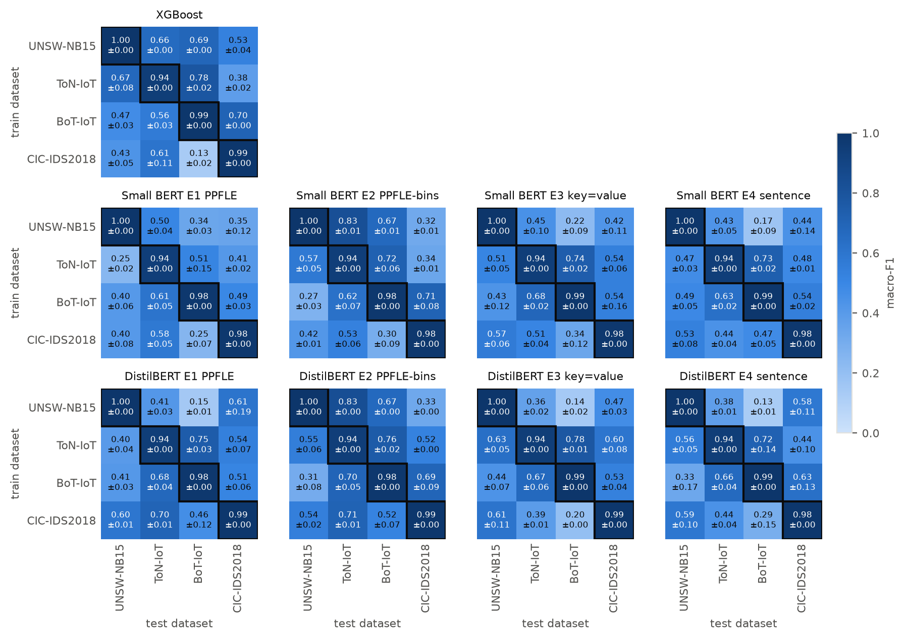
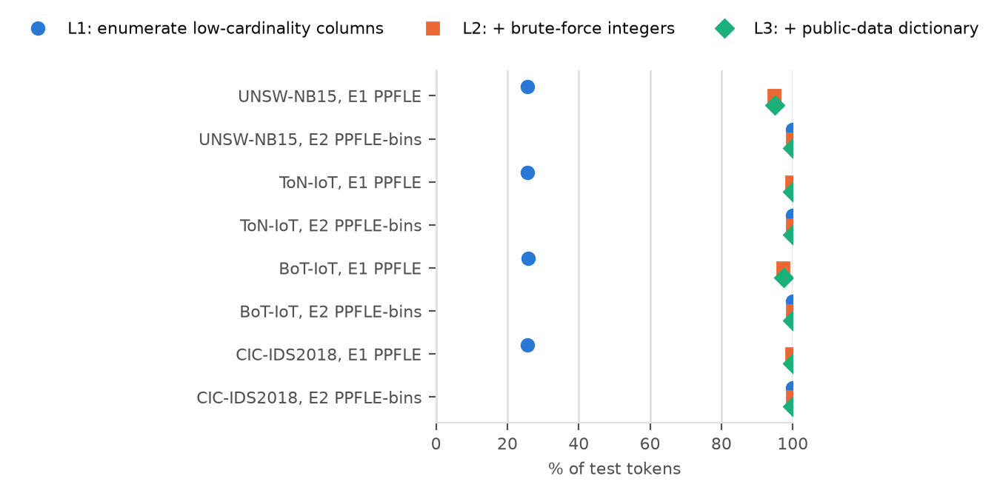
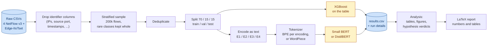

<div align="center">

# Flows to Words: Does the Encoding Matter?

**How should a network flow be written as text so that a language model can detect attacks in it?**




</div>

Language models are increasingly used for network intrusion detection. To use one, each flow record (one row of
summary statistics for one connection) first has to be turned into text. **SecurityBERT** does this by hashing every
`column$value` pair (*PPFLE*) and reports 98.2 % accuracy on Edge-IIoTset, while claiming that the hashes keep the raw
values private.

This repository tests that idea in a controlled benchmark. It compares **four text encodings**, two language models
and a tuned **XGBoost** baseline on **five public datasets**. Every model is evaluated within a dataset, across datasets
and against a dictionary attack. Everything runs from one command and is fully reproducible.

> Course project for T-725-MALV Natural Language Processing, Reykjavik University, Fall 2026.

---

## Contents

- [Key findings](#key-findings)
- [Results](#results)
- [How it works](#how-it-works)
- [Getting started](#getting-started)
- [Live demo](#live-demo)
- [Repository layout](#repository-layout)
- [Design rules](#design-rules)
- [The report](#the-report)
- [Team and acknowledgments](#team-and-acknowledgments)

---

## Key findings

| | Question | Answer |
|---|---|---|
| 🔁 | **RQ1** Does SecurityBERT's result reproduce on Edge-IIoTset? | **Yes, but only because of a label leak.** In the published files, an empty field is spelled `"0"` in normal traffic and `"0.0"` in attack traffic. PPFLE + small BERT reaches 0.978 accuracy as published (paper: 0.982), and 0.955 once the spelling is unified. XGBoost goes from a perfect 1.000 binary macro-F1 to 0.965. |
| 📊 | **RQ2** Within one dataset, which encoding is best, and do language models beat XGBoost? | **XGBoost is as good as or better than every text model on all 5 datasets.** For DistilBERT, readable `key=value` text is the best encoding everywhere. Raw PPFLE is never the best encoding. |
| 🌍 | **RQ3** Trained on one network, tested on another: which encoding transfers best? | **Binning before hashing.** Off-diagonal macro-F1 rises from 0.424 to 0.524 (small BERT) and from 0.517 to 0.594 (DistilBERT). DistilBERT with binned PPFLE is the only method that beats XGBoost (0.552) when transferring. |
| 🔓 | **RQ4** Is PPFLE privacy-preserving? | **No.** The hash is unsalted, so a dictionary attack that knows only the public feature list reverses 95.0–99.9 % of the PPFLE tokens on the NetFlow test sets and 97.9 % on Edge-IIoTset. Binned PPFLE is reversed completely (to the bin). |

<details>
<summary><b>Hypotheses</b> (verdicts computed automatically in <code>results/analysis_summary.md</code>)</summary>

| | Hypothesis | Verdict |
|---|---|---|
| H1 | PPFLE does well within a dataset (within 0.05 of the best method) | mixed, 2 of 5 datasets |
| H2 | XGBoost is as good or better within a dataset | **supported**, 5 of 5 |
| H3 | Readable or binned encodings transfer better than raw PPFLE | mixed, 4 of 6 (binning helps both models; readable text only helps the small BERT) |
| H4 | A pretrained model benefits from readable encodings, but not from hashes | mixed, 14 of 24 (across datasets, pretraining helps on hashes instead) |

Two numbers count as different only if they differ by more than 0.01 *and* by more than the larger seed standard
deviation; otherwise they are a tie.
</details>

---

## Results

All numbers are on the held-out test split, mean ± std over 3 seeds. The full tables, error analysis and figures are
regenerated from `results/results.csv` with `uv run ftw analysis`.

### Within one dataset (Experiment 2, multiclass macro-F1)

| Method | UNSW-NB15 | ToN-IoT | BoT-IoT | CIC-IDS2018 | Edge-IIoTset |
|---|---:|---:|---:|---:|---:|
| **XGBoost** | **0.671** | **0.873** | **0.989** | 0.945 | 0.905 |
| Small BERT · E1 PPFLE | 0.449 | 0.854 | 0.935 | 0.764 | 0.835 |
| Small BERT · E2 binned PPFLE | 0.504 | 0.838 | 0.955 | 0.900 | 0.742 |
| Small BERT · E3 key=value | 0.471 | 0.856 | 0.938 | 0.844 | 0.817 |
| Small BERT · E4 sentence | 0.411 | 0.828 | 0.947 | 0.768 | 0.867 |
| DistilBERT · E1 PPFLE | 0.479 | 0.854 | 0.896 | 0.938 | 0.836 |
| DistilBERT · E2 binned PPFLE | 0.553 | 0.846 | 0.961 | 0.936 | 0.746 |
| DistilBERT · E3 key=value | 0.591 | 0.864 | 0.979 | **0.947** | **0.907** |
| DistilBERT · E4 sentence | 0.522 | 0.863 | 0.978 | 0.944 | 0.902 |

Where DistilBERT E3 is ahead (CIC-IDS2018, Edge-IIoTset), the lead is within the tie margin. Standard deviations:
[`results/exp2_within_macro_f1.md`](results/exp2_within_macro_f1.md).

<p align="center"></p>

### Across datasets (Experiment 3, binary)

Every model is trained on one NetFlow dataset and tested on all four. On the diagonal (same dataset), every method
detects attacks almost perfectly (macro-F1 ≈ 0.98). Off the diagonal, performance drops sharply, and the encoding
decides whether a language model beats XGBoost at all:

| Method | same dataset | **other dataset** | attack recall (other) | FPR (other) |
|---|---:|---:|---:|---:|
| XGBoost | 0.979 | 0.552 ± 0.018 | 0.575 | 0.347 |
| Small BERT · E1 PPFLE | 0.977 | 0.424 ± 0.008 | 0.478 | 0.481 |
| Small BERT · E2 binned PPFLE | 0.976 | 0.524 ± 0.010 | 0.559 | 0.411 |
| DistilBERT · E1 PPFLE | 0.977 | 0.517 ± 0.023 | 0.470 | 0.290 |
| **DistilBERT · E2 binned PPFLE** | 0.977 | **0.594 ± 0.025** | **0.642** | 0.363 |
| DistilBERT · E3 key=value | 0.980 | 0.485 ± 0.006 | 0.383 | 0.262 |

All methods: [`results/exp3_cross.md`](results/exp3_cross.md).

<p align="center"></p>

### Is PPFLE private? (Experiment 4)

The attacker knows the hashing scheme and the public NetFlow column list, but not the data. The attack runs in three
cumulative levels, and every recovered token is checked against the true value (0 wrong guesses):

1. **Enumerate** every value of the low-cardinality columns (ports, protocols, TCP flags, TTLs) and every bin label.
2. **Brute-force** every whole number from 0 to 1,000,000 for the remaining numeric columns.
3. **Dictionary** of the values seen in the *other* public datasets.

| Dataset | E1 tokens reversed | whole flows reversed | E2 tokens reversed |
|---|---:|---:|---:|
| NF-UNSW-NB15 | 95.0 % | 3.8 % | 100 % |
| NF-ToN-IoT | 99.9 % | 93.5 % | 100 % |
| NF-BoT-IoT | 97.5 % | 11.4 % | 100 % |
| NF-CSE-CIC-IDS2018 | 99.9 % | 95.7 % | 100 % |
| Edge-IIoTset, as published (levels 1–2 only) | 97.9 % | 19.5 % | 99.9 % |

<p align="center"></p>

What resists are fractional bytes-per-second rates, very large counters and TCP sequence numbers. Deterministic
hashing of low-entropy fields is pseudonymisation, not privacy protection.

<details>
<summary><b>More results</b>: accuracy, per-class error analysis, leakage check, timings</summary>

- Test accuracy, for comparison with the SecurityBERT paper: [`results/exp2_within_accuracy.md`](results/exp2_within_accuracy.md)
- Edge-IIoTset replication, as published vs. fixed: [`results/exp1_replication.md`](results/exp1_replication.md)
- Per-class F1 and confusion matrices: [`results/error_analysis.md`](results/error_analysis.md) and `report/generated/figures/{perclass_f1,confusion}_*.png`
- Single-feature leakage check: [`results/leakage_check.md`](results/leakage_check.md), [`results/leakage_check_edge.md`](results/leakage_check_edge.md)
- DistilBERT truncation side runs (hashes are cut at 512 WordPieces): [`results/exp2_side_runs.md`](results/exp2_side_runs.md)
- Privacy attack per column: [`results/privacy_attack.md`](results/privacy_attack.md), [`results/privacy_attack_edge.md`](results/privacy_attack_edge.md)
- Datasets after cleaning, text lengths, tokenizers: [`results/dataset_stats.md`](results/dataset_stats.md), [`results/encoding_stats.md`](results/encoding_stats.md), [`results/tokenizer_stats.md`](results/tokenizer_stats.md)
- Training time per run (median): XGBoost ~8 s, small BERT ~7 min (laptop RTX A3000), DistilBERT ~84 min on the laptop or ~7 min on an A100.

</details>

---

## How it works

### Pipeline



Bin edges, tokenizers and learning rates are fitted on the **train** and **validation** splits only. The **test** split
is read once, by the final runs.

### Encodings

| | Encoding | What a token looks like | Keeps numeric order? | Readable? |
|---|---|---|:---:|:---:|
| **E1** | PPFLE (as in SecurityBERT) | `sha256("IN_BYTES$4704")[:16]` → `46928dd8ca3a3f99` | ✗ | ✗ |
| **E2** | PPFLE on quantile bins | `sha256("IN_BYTES$bin8")[:16]` → `7fc09090edd30595` (10 bins per column, fitted on train) | coarse | ✗ |
| **E3** | `key=value` text | `in bytes=4704` | ✓ | ✓ |
| **E4** | Sentence template | `The client sent 28 packets (4704 bytes) over 334 milliseconds.` | ✓ | ✓ |

All encodings list the features in the same fixed order and write missing values as `NA`. Categorical columns (ports,
protocols, flags) are hashed raw in E2, and floats are rounded to 2 decimals in E3/E4.

### Models

| Model | Size | Tokenizer | Notes |
|---|---|---|---|
| **XGBoost** | gradient-boosted trees | none (reads the table) | depth, learning rate and class weights tuned on validation, early stopping |
| **Small BERT** | 4 layers, hidden 128, 4 heads (1.5 M params) | byte-level BPE, 5,000 tokens, trained per encoding on the train split | trained from scratch; the size stated for SecurityBERT |
| **DistilBERT** | `distilbert-base-uncased` (67 M params) | its own pretrained WordPiece | fine-tuned for 3 epochs; brings knowledge of English, which tests whether readable text helps |

### Datasets

| Dataset | Raw flows | Used (after cleaning) | Classes | Benign share |
|---|---:|---:|---:|---:|
| [NF-UNSW-NB15 v3](https://staff.itee.uq.edu.au/marius/NIDS_datasets/) | 2.4 M | 134,437 | 10 | 85.6 % |
| [NF-ToN-IoT v3](https://staff.itee.uq.edu.au/marius/NIDS_datasets/) | 27.5 M | 98,975 | 10 | 58.6 % |
| [NF-BoT-IoT v3](https://staff.itee.uq.edu.au/marius/NIDS_datasets/) | 16.9 M | 133,648 | 5 | 15.4 % |
| [NF-CSE-CIC-IDS2018 v3](https://staff.itee.uq.edu.au/marius/NIDS_datasets/) | 20.1 M | 132,579 | 11 | 86.6 % |
| [Edge-IIoTset](https://www.kaggle.com/datasets/mohamedamineferrag/edgeiiotset-cyber-security-dataset-of-iot-iiot) | 2.2 M | 193,066 | 15 | 72.4 % |

The four NetFlow datasets share one feature set (47 features after cleaning), which makes the 4 × 4 cross-dataset
grid possible. Cross-dataset runs use the binary label, because attack names differ between datasets.

---

## Getting started

### 1. Install

The environment is managed with [uv](https://docs.astral.sh/uv/) (Linux, macOS, Windows; Python 3.12, versions pinned
in `uv.lock`):

```bash
git clone https://github.com/timliebhaber/Flows-to-Words-Does-the-Encoding-Matter.git
cd Flows-to-Words-Does-the-Encoding-Matter
uv sync
```

<sub>Without uv: `python -m venv .venv && pip install -e .`, then use `ftw` instead of `uv run ftw`.</sub>

### 2. Get the data

Put the raw files in `data/raw/` (gitignored):

| File | Source |
|---|---|
| `nf-unsw-nb15_v3.csv`, `nf-ton-iot_v3.csv`, `nf-bot-iot_v3.csv`, `nf-cse-cic-ids2018_v3.csv` | [UQ NIDS datasets](https://staff.itee.uq.edu.au/marius/NIDS_datasets/) (NetFlow v3) |
| `DNN-EdgeIIoT-dataset.csv` | [Kaggle: Edge-IIoTset](https://www.kaggle.com/datasets/mohamedamineferrag/edgeiiotset-cyber-security-dataset-of-iot-iiot), folder "Selected dataset for ML and DL" (only needed for the `edge` group) |

### 3. Look before you run

```bash
uv run ftw --dry-run      # what is done, what is left, rough time, exact commands (~15 s)
uv run ftw --list         # all groups and stages
```

### 4. Run

One command runs the whole pipeline or any part of it. **Finished work is always skipped**, so after a crash (or a
laptop sleep) you simply rerun the same command.

```bash
uv run ftw                        # everything that is left
uv run ftw xgb                    # one group: data → XGBoost tuning → final runs
uv run ftw encoders tokenizers    # specific stages
uv run ftw bert_small_final --encoding e3_kv --task binary   # filter by encoding / dataset / task
uv run ftw analysis               # rebuild every table, figure and report number from results.csv
```

Long runs are best started in the background:

```bash
mkdir -p logs && nohup uv run ftw bert_small > logs/bert_small.log 2>&1 &
tail -f logs/bert_small.log
```

| Group | What it does | Rough time |
|---|---|---|
| `data` | clean, sample, dedupe, split → Parquet | 5–10 min (CPU) |
| `leakage` | XGBoost on every single feature | ~25 min (CPU) |
| `xgb` | tuning + 3 seeds × 4 datasets × 2 tasks | ~5 min (GPU) |
| `encoders`, `tokenizers` | E2 bin edges, text stats, BPE tokenizers | ~10 min |
| `bert_small` | tuning + all final runs | ~16 h (RTX A3000 laptop GPU) |
| `distilbert` | tuning + all final runs | ~65 h per seed on a laptop GPU; much faster on an A100 |
| `edge` | everything above for Edge-IIoTset | ~37 h (31 h of it DistilBERT) |
| `privacy`, `privacy_edge` | dictionary attack | < 1 min per dataset (CPU) |
| `analysis` | tables, figures, verdicts, LaTeX numbers | ~20 s (CPU) |

> [!NOTE]
> The models expect a CUDA GPU by default (`device: cuda` in `configs/xgb.yaml`, `configs/bert_small.yaml` and
> `configs/distilbert.yaml`). XGBoost and the analysis also run fine on a CPU. `cluster/` holds SLURM job scripts for
> running DistilBERT seeds on an HPC cluster.

### 5. Test

```bash
uv run pytest           # unit tests + integrity checks on the processed data
uv run ruff check .     # lint
```

---

## Live demo

An interactive Streamlit app walks a visitor through the project in five steps: a random flow, the same flow being
encoded live into E1–E4, a guessing game against three classifiers, a live brute-force/dictionary attack on the hashes,
and the headline results.

```bash
uv run ftw demo                                                   # train the demo models once (~6 min GPU)
uv run streamlit run src/demo/app.py -- --config configs/demo.yaml
```

---

## Repository layout

```text
.
├── configs/                 every parameter, one YAML per stage (nothing is hard-coded)
│   ├── pipeline.yaml        stages, order, dependencies and "done" checks for `ftw`
│   ├── data.yaml, datasets/ columns to drop, sampling, splits, per-dataset settings
│   ├── encoders.yaml        hash, bins, separator, templates for E1–E4
│   ├── xgb.yaml, bert_small.yaml, distilbert.yaml, *_edge.yaml
│   └── analysis.yaml, privacy.yaml, demo.yaml
├── src/
│   ├── run.py               the `ftw` command
│   ├── data/                load → clean → sample → dedupe → split
│   ├── encoders/            E1 PPFLE, E2 binned PPFLE, E3 key=value, E4 sentence
│   ├── tokenizers/          byte-level BPE per encoding
│   ├── models/              XGBoost, small BERT, DistilBERT (shared tune/final/resume logic)
│   ├── eval/                metrics, leakage check, analysis, hypotheses, figures, privacy attack
│   └── demo/                Streamlit demo app
├── results/                 results.csv (one row per run), run_details/, generated .md tables
├── report/                  LaTeX report (ACL format); report/generated/ holds tables, figures, numbers
├── tests/                   pytest suite
├── cluster/                 SLURM scripts for the GPU cluster
├── presentation/            pitch script, demo runbook, Q&A sheet
├── docs/                    images for this README
└── flows-to-words-project-plan.md   the original project plan
```

---

## Design rules

These rules are what make the comparison fair, and the code and tests enforce them:

- **No identifiers.** IP addresses, the source port, timestamps and similar columns are dropped before anything else,
  so models learn behaviour, not hosts. The destination port is kept.
- **Deduplicate, then split.** Exact duplicates and flows with identical features but different labels are removed
  before the train/validation/test split.
- **Fit on train only.** Bin edges, tokenizers and learning rates never see the test split. The test split is read
  once, at the end.
- **Same data for everyone.** Every method uses the same samples, splits and columns, with fixed seeds and 3 seeds per
  model.
- **Macro-F1 first.** It is the primary metric; accuracy is reported for comparison with the paper, and cross-dataset
  runs also report attack recall and false-positive rate.
- **No hard-coded parameters.** Every setting lives in `configs/`, from file paths to learning rates.
- **No typed numbers in the report.** Every number, table cell and figure in the report is generated from
  `results/results.csv` (e.g. `\res{exp2.xgboost.none.nf_unsw_nb15.macro_f1}`), so the paper can never disagree with
  the results.

Every run appends one row to `results/results.csv`:

```text
run_id, date, experiment, encoding, model, train_dataset, test_dataset, task, seed, n_train, max_len,
macro_f1, accuracy, attack_recall, fpr, train_time_s, infer_time_ms, notes
```

---

## The report

The paper is in [`report/`](report/) (ACL two-column format, one file per section in `report/sections/`). To build the
PDF locally:

```bash
uv run ftw analysis privacy privacy_edge    # refresh generated tables, figures and numbers (optional)
tectonic -X compile report/main.tex         # or: cd report && latexmk -pdf main.tex
```

---

## Team and acknowledgments

**Daniel Z. El Deen K. Al Hennaw · Tim Liebhaber · Vid Kališnik**
Reykjavik University, T-725-MALV Natural Language Processing, Fall 2026. Supervisor: Stefán Ólafsson.

Computer resources and research IT are provided by UTS at the University of Iceland through the Icelandic Research
e-Infrastructure project (IREI), funded by the Icelandic Infrastructure Fund. The second and third DistilBERT seeds
were trained on its Elja cluster.

This project builds on SecurityBERT and PPFLE (Ferrag et al., 2024), the Edge-IIoTset dataset (Ferrag et al., 2022)
and the NetFlow datasets of Sarhan et al. (2021). Full references are in [`report/references.bib`](report/references.bib).
