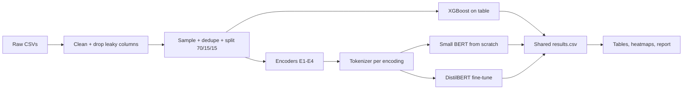

# Flows to Words: Does the Encoding Matter?

**Turning network traffic tables into language for intrusion detection**

NLP course group project · 3 people · 4 weeks (about Oct 1 to Oct 29, 2026)

---

## 0. The project in 60 seconds

Network intrusion detection datasets are **tables**. Each row is one network connection (a "flow") described by numbers: how many bytes, how many packets, which port, how long it lasted. Each row has a label: normal traffic or a specific attack.

Language models like BERT do not read tables. They read **text**. So if we want to use NLP models on this data, we first have to **turn each table row into a piece of text**. We call that step **encoding** (or serialization).

A 2024 paper (SecurityBERT) did this with a trick called **PPFLE**: it hashes every `column$value` pair into a random-looking string and feeds those strings to a small BERT. It reported 98.2% accuracy.

**Our question:** does the *way* we turn a row into text actually matter? We will:

1. **Reproduce** PPFLE on the dataset from the original paper.
2. **Compare 4 different encodings** (hashed, hashed + grouped numbers, plain `key=value` text, natural-language sentences).
3. **Compare against a strong non-NLP baseline** (XGBoost on the raw table).
4. **Test on several datasets**, including training on one dataset and testing on a different one. This is where we expect the encodings to really differ.

The output is a benchmark: a clear table that shows which encoding works best, on which data, and why.

---

## 1. Background in plain words

### 1.1 What is a network flow?

When two computers talk, they exchange many small packets. A **flow** groups all packets of one conversation, for example "computer A talked to a web server on port 80 for 12 milliseconds". A tool like NetFlow summarises each flow as one row with columns such as:

| Column | Meaning | Example |
|---|---|---|
| `PROTOCOL` | Transport protocol (6 = TCP, 17 = UDP) | 6 |
| `L7_PROTO` | Application protocol (7 = HTTP) | 7.0 |
| `L4_DST_PORT` | Destination port | 80 |
| `IN_BYTES` / `OUT_BYTES` | Bytes sent each direction | 1520 / 40 |
| `IN_PKTS` / `OUT_PKTS` | Packets sent each direction | 5 / 1 |
| `TCP_FLAGS` | Which TCP flags appeared | 27 |
| `FLOW_DURATION_MILLISECONDS` | How long the flow lasted | 12 |
| `Label` / `Attack` | Benign or attack, and which attack | 1 / "DoS" |

### 1.2 What is an intrusion detection system (NIDS)?

A system that watches flows and flags the bad ones. In ML terms it is a **classifier**:

- **Binary:** benign vs. attack.
- **Multi-class:** benign, DoS, scanning, injection, backdoor, and so on.

### 1.3 Why turn a table into language?

- Language models are very good at finding patterns in sequences of tokens.
- If table rows become "sentences", we can reuse the whole NLP toolbox: tokenizers, pre-trained models, fine-tuning.
- The open question is whether this actually beats normal tabular ML, and whether it **generalises** better to new networks.

### 1.4 Why this is an NLP project

The core of the project is about **representation and tokenization**: how do you write structured data as text so that a language model can learn from it? We study tokenizers, sequence models, pre-trained vs. from-scratch transformers, and how the "language" we design affects learning. The network data is the domain. The research is about language representation.

---

## 2. Research questions

| ID | Question | Why it matters |
|---|---|---|
| **RQ1** | Can we reproduce the PPFLE + SecurityBERT result on Edge-IIoTset? | Replication is the foundation. If it does not reproduce, that is a finding by itself. |
| **RQ2** | Within one dataset, how do the 4 encodings compare to each other and to XGBoost? | The original paper compared against weak tree baselines (Random Forest at 80.8%). A well-tuned XGBoost is a fairer test. |
| **RQ3** | If we train on one dataset and test on another, which encoding generalises best? | Real networks differ from training data. Hashing turns every exact value into an unrelated token, so we expect it to transfer worst. |
| **RQ4** *(stretch)* | Is PPFLE actually privacy-preserving? | Many columns have few possible values (ports, protocols). An unsalted hash of those can be reversed by trying every value. |

**Our hypotheses (to be tested, not assumed):**

- H1: PPFLE does well **within** one dataset.
- H2: XGBoost is as good or better within one dataset.
- H3: Encodings that keep numbers readable (`key=value`, sentences) or grouped (binned hashing) **transfer better across datasets** than raw PPFLE.
- H4: The pretrained DistilBERT benefits from readable encodings but gains nothing on hashes, because hashes carry no English meaning.

A negative result (for example "no encoding beats XGBoost") is still a valid and interesting result. We report what we find.

---

## 3. Key concepts (glossary)

| Term | Simple explanation |
|---|---|
| **Encoding / serialization** | The rule that turns one table row into one piece of text. |
| **Token** | The smallest unit a language model reads. Could be a word, part of a word, or a few characters. |
| **Tokenizer** | The tool that splits text into tokens. |
| **BPE (Byte-Pair Encoding)** | A tokenizer that learns common chunks from data. Frequent strings become one token. Rare strings are split into smaller pieces. |
| **Hash function** | Turns any string into a fixed-length random-looking string. Same input gives the same output. Similar inputs give completely different outputs. |
| **PPFLE** | "Privacy-Preserving Fixed-Length Encoding". Hash each `column$value` pair, then join the hashes with spaces. |
| **Binning** | Grouping numbers into ranges. For example, all byte counts between 1000 and 2000 go to "bin 7". |
| **Quantile binning** | Bins chosen so each bin holds roughly the same number of training rows. |
| **From-scratch model** | A model with random starting weights, trained only on our data. |
| **Pre-trained model** | A model that already learned English from huge text corpora (DistilBERT). We fine-tune it on our data. |
| **XGBoost** | A strong, fast tree-based model for tables. The standard baseline to beat. |
| **Macro-F1** | Compute F1 for each class, then average them equally. Rare attack classes count as much as common ones. Our main metric. |
| **Cross-dataset evaluation** | Train on dataset A, test on dataset B. Measures generalisation to a new network. |
| **Data leakage** | When the model learns a shortcut (like an IP address) instead of real attack behaviour. Gives fake high scores. |

---

## 4. Datasets

### 4.1 Overview

We use **two groups** of datasets.

**Group A: Edge-IIoTset (for replication, RQ1)**

| Property | Value |
|---|---|
| What | IoT and industrial IoT traffic from a realistic testbed |
| Rows | About 2.2 million (the "DNN" CSV version used by SecurityBERT) |
| Classes | 15 (normal + 14 attacks: DoS/DDoS variants, scanning, fingerprinting, MITM, SQL injection, XSS, uploading, password attacks, backdoor, ransomware) |
| Features | 61 |
| Where | Kaggle / IEEE DataPort (search "Edge-IIoTset Ferrag") |

**Group B: the UQ NetFlow family (for cross-dataset tests, RQ2 and RQ3)**

The University of Queensland converted 4 well-known datasets into the **same NetFlow feature set**. This is the key reason we chose them: the columns are identical, so we can train on one and test on another.

| Dataset | Original source | Flows (v3) | Example attack types |
|---|---|---|---|
| NF-UNSW-NB15 | UNSW Canberra, 2015 | 2.4M | Exploits, Fuzzers, Generic, Reconnaissance, DoS, Backdoor, Shellcode, Worms |
| NF-ToN-IoT | UNSW, IoT testbed | 27.5M | Scanning, DoS, DDoS, Injection, XSS, Password, Ransomware, Backdoor, MITM |
| NF-BoT-IoT | UNSW, IoT botnets | 17.0M | DoS, DDoS, Reconnaissance, Theft |
| NF-CSE-CIC-IDS2018 | Canadian Inst. for Cybersecurity | 20.1M | Brute force, Bot, DoS, DDoS, Infiltration, Web attacks |

- **Version:** v3 (53 features) is the primary choice. **Fallback:** v2 (43 features), which is more widely used and mirrored on Kaggle.
- Each file has a binary `Label` column (0 = benign, 1 = attack) and an `Attack` column (attack name).
- Attack type names differ between datasets. So **cross-dataset tests use the binary label only**. Multi-class is done within a single dataset.

### 4.2 Sampling (the datasets are huge)

Millions of rows are too many for 4 weeks of BERT training. So:

- Take a **stratified sample of about 200k rows per dataset** (keeps the class proportions).
- **Keep every row of very rare classes** (for example Worms, Infiltration) so they do not disappear.
- Record the exact sample sizes per class in the report.
- Fix the random seed so everyone gets the same sample.

### 4.3 Cleaning: columns we drop and why

Some columns let a model "cheat". These must go before anything else.

| Drop | Reason |
|---|---|
| `IPV4_SRC_ADDR`, `IPV4_DST_ADDR` | In lab datasets, the attacker machine has a fixed IP. The model would learn "this IP = attack". Useless on a new network. |
| `L4_SRC_PORT` | Source ports are chosen randomly by the operating system. Pure noise. |
| `FLOW_START_MILLISECONDS`, `FLOW_END_MILLISECONDS` (v3) | Attacks happened at specific times in the lab. Time would leak the label. |
| `DNS_QUERY_ID` | Random ID. Noise. |
| For Edge-IIoTset: `ip.src_host`, `ip.dst_host`, `frame.time`, `tcp.payload`, `http.file_data`, `http.request.full_uri` and similar | Same reasons. These are the columns the SecurityBERT paper says it removed. |

**We keep `L4_DST_PORT`** (destination port), because the service being targeted is real behaviour. Optional ablation: drop it and see how much scores fall.

### 4.4 Other preprocessing rules

- **Remove exact duplicate rows** after dropping columns. Flow datasets contain many identical rows. If the same row lands in train and test, scores are inflated.
- **Split:** 70% train, 15% validation, 15% test, stratified by class.
- **Fit everything on train only:** bin edges, tokenizers, scalers. Never look at the test set while building these.
- **Leakage sanity check:** train XGBoost on **one feature at a time**. If any single feature alone gives above 99% macro-F1, investigate it before continuing.

---

## 5. The four encodings (the heart of the project)

We take **the same example flow** and show it in all four encodings.

**Example row** (simplified to 8 columns):

```
PROTOCOL=6  L7_PROTO=7.0  L4_DST_PORT=80  IN_BYTES=1520  OUT_BYTES=40
IN_PKTS=5   OUT_PKTS=1    FLOW_DURATION_MILLISECONDS=12
```

### E1. PPFLE (as published)

**Rule:** for each column, build the string `column$value`, hash it, join all hashes with spaces.

```
PROTOCOL$6      -> 4fbfe692dd218a7c
L7_PROTO$7.0    -> 4bbe6778ca7f0d4a
L4_DST_PORT$80  -> 965debace268a1e7
IN_BYTES$1520   -> 24c24537f5a7676c
...
Text fed to the model:
"4fbfe692dd218a7c 4bbe6778ca7f0d4a 965debace268a1e7 24c24537f5a7676c ..."
```

*(These are real SHA-256 hashes, cut to 16 characters for readability.)*

**The key weakness:** `IN_BYTES$1520` becomes `24c24537...` but `IN_BYTES$1521` becomes `fd5f11ee...`. One byte of difference gives a completely unrelated token. The model cannot know these two values are almost the same. A value never seen in training becomes something the model has never seen at all.

### E2. PPFLE with binning

**Rule:** first replace each numeric value with its quantile bin (for example 10 bins per column, learned on the training set), then hash `column$binX`. Categorical columns (protocol, port) are hashed as they are.

```
IN_BYTES=1520   -> bin7 -> hash("IN_BYTES$bin7")   -> 69378708c96232be
OUT_BYTES=40    -> bin2 -> hash("OUT_BYTES$bin2")  -> 95ed1196a120e1c9
```

**Why:** now 1520 and 1521 land in the same bin and get the same token. This should fix the "unseen value" problem while keeping the hashing idea.

### E3. Plain `key=value` text (no hashing)

**Rule:** write column names and raw values as plain text.

```
"PROTOCOL=6 L7_PROTO=7.0 L4_DST_PORT=80 IN_BYTES=1520 OUT_BYTES=40 IN_PKTS=5 OUT_PKTS=1 FLOW_DURATION_MILLISECONDS=12"
```

**Why:** numbers stay readable. The tokenizer splits `1520` into pieces like `15` and `20`, so `1520` and `1521` share pieces. The SecurityBERT paper claims "BERT without PPFLE" reached only 51.3%. This encoding tests that claim directly.

### E4. Natural-language sentence

**Rule:** a fixed template that reads like English, using readable names.

```
"A TCP flow using HTTP to destination port 80 that lasted 12 milliseconds.
 The client sent 5 packets (1520 bytes). The server replied with 1 packet (40 bytes)."
```

**Why:** this is the most "language-like" version. The pretrained DistilBERT already understands words like "TCP", "client", "replied". We expect this encoding to help the pretrained model most.

### Summary table

| | E1 PPFLE | E2 PPFLE + bins | E3 key=value | E4 sentence |
|---|---|---|---|---|
| Human-readable | No | No | Yes | Yes |
| Similar numbers look similar | No | Yes (same bin) | Partly (shared digit tokens) | Partly |
| Handles unseen values | Badly | Well | OK | OK |
| Uses pretrained English knowledge | No | No | A little | Yes |
| Hides raw values ("privacy") | Claimed | Claimed | No | No |

### Implementation details we have fixed in advance

- **Column order is fixed** and identical for every row and every dataset.
- **Hash function:** SHA-256 (the paper does not say which one it used), cut to 16 hex characters. A shorter hash keeps sequences short. Collisions at 16 characters are negligible.
- **Separator:** `$`, as in the paper.
- **Missing values:** written as the string `NA` before hashing or printing.
- **Number formatting for E3 and E4:** round floats to at most 2 decimals so `12.000000` does not waste tokens.
- **Sequence length:** measure the token length of each encoding on the train set. Set `max_length` to cover 99% of rows. Report it. Hashes split into several BPE pieces, so E1 and E2 will be longer than you might expect.

---

## 6. Models

We run **3 model types**. Every encoding goes through the two language models. XGBoost works on the raw table and needs no encoding.

### 6.1 XGBoost (the non-NLP baseline)

- Input: the cleaned table directly (numbers as numbers).
- Light tuning on the validation set: number of trees, max depth, learning rate.
- **Why it is essential:** if a language model cannot beat a fast tree model, we need to say so. Reviewers and the instructor will ask.

### 6.2 Small BERT from scratch ("SecurityBERT-style")

Same size as in the paper:

| Setting | Value |
|---|---|
| Layers | 4 |
| Hidden size | 128 |
| Attention heads | 4 |
| Feed-forward size | 512 |
| Parameters | About 11M |
| Tokenizer | Byte-level BPE, vocabulary 5,000, min frequency 2, **trained separately for each encoding on the train split** |
| Training | Classification head on the `[CLS]`/`<s>` token, batch size 128, about 4 epochs, AdamW, learning rate around 5e-4 with warmup (tune on validation) |

**Why:** this is the model PPFLE was designed for. It is small and fast to train.

### 6.3 DistilBERT, fine-tuned (pretrained)

| Setting | Value |
|---|---|
| Model | `distilbert-base-uncased` (66M parameters) |
| Tokenizer | Its own pretrained WordPiece tokenizer (not retrained) |
| Training | 2 to 3 epochs, learning rate around 3e-5, batch size 32 to 64 |

**Why:** tests whether English pre-training helps. It should help readable encodings (E3, E4) and do nothing for hashes (E1, E2).

### 6.4 Out of scope (unless we have spare time)

- Large LLMs (7B+) with prompting. A recent paper found prompt-only LLMs well below XGBoost on UNSW-NB15 (about 0.78 vs. 0.95 macro-F1), and they are slow. Not worth our limited time.

---

## 7. Benchmark design (how we test everything)

### 7.1 Metrics

| Metric | Used for | Why |
|---|---|---|
| **Macro-F1** (primary) | Everything | Classes are imbalanced. Accuracy alone hides failures on rare attacks. |
| Accuracy | Everything | To compare with the SecurityBERT paper. |
| Per-class F1 + confusion matrix | Best runs | Shows which attacks get confused. |
| Attack recall and false positive rate | Cross-dataset (binary) | In practice: "how many attacks did we catch" and "how many false alarms". |
| Training time and inference time | Everything | Practical cost of each approach. |

### 7.2 Experiments

**Experiment 1: Replication (RQ1)**
- Data: Edge-IIoTset, 15 classes.
- Run: E1 PPFLE + small BERT. Also XGBoost.
- Success: within a few points of 98.2% accuracy. If not, document exactly what differs.

**Experiment 2: Within-dataset benchmark (RQ2)**
- Data: Edge-IIoTset + the 4 NetFlow datasets, each on its own (multi-class).
- Run: every encoding (E1 to E4) x every language model (small BERT, DistilBERT) + XGBoost.
- Output: one big table. Rows = encoding/model. Columns = datasets. Cells = macro-F1.

**Experiment 3: Cross-dataset benchmark (RQ3)**
- Data: the 4 NetFlow datasets (same columns), **binary** label.
- Run: train on each dataset, test on all 4 (including itself). That gives a 4 x 4 grid per (encoding, model).
- Output: one heatmap per encoding. Diagonal = same dataset. Off-diagonal = transfer.
- Summary number: **average off-diagonal macro-F1** = "how well does it generalise".

Example of the grid for one encoding:

| Train \ Test | UNSW-NB15 | ToN-IoT | BoT-IoT | CIC-IDS2018 |
|---|---|---|---|---|
| UNSW-NB15 | (same) | ? | ? | ? |
| ToN-IoT | ? | (same) | ? | ? |
| BoT-IoT | ? | ? | (same) | ? |
| CIC-IDS2018 | ? | ? | ? | (same) |

**Experiment 4 (stretch): Privacy attack on PPFLE (RQ4)**
- For each low-cardinality column (protocol, ports, flags, application protocol), list every possible value, hash `column$value`, and match against the PPFLE tokens.
- Report: the % of tokens in the test set we can reverse to their original value.

### 7.3 Fairness rules for the benchmark

- Same samples, same splits, same cleaned columns for every method.
- Tuning only on the validation set. Test set is touched **once** at the end.
- **3 random seeds** for the small BERT and XGBoost runs. Report mean and standard deviation. DistilBERT: 1 seed if compute is tight, 3 for the final best configurations.
- Every run writes one row to a shared results file (see Section 9).

### 7.4 How many runs is this?

| Experiment | Runs (1 seed) |
|---|---|
| Exp 1: replication | 2 |
| Exp 2: 5 datasets x (4 encodings x 2 models + XGBoost) | 45 |
| Exp 3: 4 train datasets x (4 encodings x 2 models + XGBoost) | 36 trainings (testing on the other 3 is cheap) |

Small BERT on 200k rows trains in minutes on one GPU. DistilBERT is the expensive one. If compute is short, see the priority tiers in Section 8.4.

---

## 8. Roadmap

### 8.1 Pipeline at a glance



### 8.2 Week-by-week plan

**Week 1 (Oct 1 to 7): Data and foundations**
- Download Edge-IIoTset and the 4 NetFlow datasets (v3, fall back to v2).
- Write loaders and the cleaning script (Section 4.3).
- Sample, dedupe, split. Save processed files as Parquet.
- Run the leakage sanity check.
- Train XGBoost on all 5 datasets. **First real numbers by end of week.**
- Write the 4 encoders and unit-test them on the example row from Section 5.
- *Checkpoint:* processed data + XGBoost baselines + encoders working.

**Week 2 (Oct 8 to 14): Replication and within-dataset runs**
- Train BPE tokenizers per encoding.
- Replicate PPFLE + small BERT on Edge-IIoTset (Experiment 1).
- Run small BERT on all encodings x all datasets.
- Start DistilBERT runs.
- *Checkpoint:* replication result + first version of the Experiment 2 table.

**Week 3 (Oct 15 to 21): Cross-dataset and depth**
- Run the 4 x 4 cross-dataset grids (Experiment 3).
- Finish DistilBERT runs.
- Extra seeds for the key configurations.
- Stretch: privacy attack (Experiment 4), drop-the-port ablation, bin count ablation (5 vs. 10 vs. 20 bins).
- *Checkpoint:* all main numbers done. **Freeze experiments at end of week.**

**Week 4 (Oct 22 to 29): Analysis and write-up**
- Error analysis: confusion matrices, which attacks fail, which transfers fail and why.
- Make final figures: big comparison table, cross-dataset heatmaps, token length per encoding.
- Write the report and prepare the presentation.
- Clean up the repo so results can be reproduced from scratch.

### 8.3 Who does what

| Role | Owns | Main deliverables |
|---|---|---|
| **Person A: Data and encodings** | Loading, cleaning, sampling, splits, the 4 encoders, tokenizers | Processed datasets, `encoders/`, leakage check, dataset statistics table |
| **Person B: Models and training** | XGBoost, small BERT, DistilBERT, training scripts and configs | Training code, all within-dataset runs, replication result |
| **Person C: Evaluation and analysis** | Metrics, cross-dataset grid, privacy attack, figures | `results.csv`, heatmaps, error analysis, leads the write-up |

Everyone writes their own part of the report. Everyone reviews each other's code once a week.

### 8.4 Priority tiers (if we run out of time)

| Tier | Contents |
|---|---|
| **Must have (MVP)** | Clean data. XGBoost baselines. PPFLE replication on Edge-IIoTset. E1 vs. E3 with small BERT on all datasets. Cross-dataset grid for at least 2 NetFlow datasets. |
| **Core** | All 4 encodings. DistilBERT. Full 4 x 4 cross-dataset grid. 3 seeds on key runs. |
| **Stretch** | Privacy attack. Port and bin-count ablations. LLM prompting comparison. |

---

## 9. Repository and tooling

### 9.1 Suggested repo layout

```
flows-to-words/
├── README.md               <- short version of this file
├── configs/                <- one YAML per experiment (dataset, encoding, model, seed)
├── data/                   <- gitignored
│   ├── raw/
│   └── processed/
├── src/
│   ├── data/               <- load.py, clean.py, sample_split.py
│   ├── encoders/           <- ppfle.py, ppfle_binned.py, kv_text.py, sentence.py
│   ├── tokenizers/         <- train_bpe.py
│   ├── models/             <- xgb.py, bert_small.py, distilbert.py
│   └── eval/               <- metrics.py, cross_dataset.py, privacy_attack.py
├── results/
│   └── results.csv         <- one row per run
├── notebooks/              <- exploration and figures only
└── report/
```

### 9.2 Tools

- Python, pandas (or polars), Parquet files
- scikit-learn, xgboost
- Hugging Face `transformers`, `tokenizers`, `datasets`
- Experiment logging: a shared `results.csv` (plus Weights & Biases if we want)
- GPU: university cluster or Colab

### 9.3 Results file format

Every run appends one row:

```
run_id, date, experiment, encoding, model, train_dataset, test_dataset, task(binary|multiclass),
seed, n_train, max_len, macro_f1, accuracy, attack_recall, fpr, train_time_s, infer_time_ms, notes
```

This makes it trivial to build every table and heatmap with a single notebook.

---

## 10. Risks and how we handle them

| Risk | What we do |
|---|---|
| Datasets too large to download or process | Use v2 instead of v3, or download only the needed files. Sample early and save Parquet. |
| Replication fails (far below 98.2%) | Document every difference (columns, split, hash). A careful failed replication is a valid result. |
| Data leakage gives fake ~100% scores | Drop leaky columns, dedupe, run the one-feature check. |
| DistilBERT too slow | Smaller samples (100k), shorter `max_length`, or run it only on the best 2 encodings. |
| Hash sequences too long for 512 tokens | Already cut hashes to 16 characters. Check token lengths in Week 1. |
| Everything scores ~99% within a dataset, so no differences show up | That is expected. The cross-dataset grid (Exp 3) is where differences should appear. |
| Cross-dataset scores are all near random | Still a finding. Report it, and analyse which features shift most between datasets. |
| Team member blocked | Short check-in twice a week. Shared results file means no one waits on another person's notebook. |

---

## 11. What success looks like

By the end we can show:

1. **A replication verdict** on PPFLE: does 98.2% hold up?
2. **One big benchmark table**: 4 encodings x 2 language models + XGBoost, across 5 datasets.
3. **Cross-dataset heatmaps** showing which encoding generalises to new networks.
4. **A clear, evidence-based answer** to "does the way you turn a table into language matter?", including where NLP methods help and where plain XGBoost is enough.
5. *(Stretch)* A measurement of how "private" PPFLE really is.

---

## 12. Open decisions for the team

- [ ] v3 or v2 of the NetFlow datasets? (Decide after checking download sizes in Week 1.)
- [ ] Sample size per dataset: 200k, or smaller if compute is tight?
- [ ] Number of bins for E2: start with 10.
- [ ] Which GPU do we use, and how many hours do we have?
- [ ] Confirm with the instructor that this framing (representation and tokenization study) fits the NLP course.

---

## 13. References

- Ferrag et al. (2024). *Revolutionizing Cyber Threat Detection with Large Language Models: A privacy-preserving BERT-based Lightweight Model for IoT/IIoT Devices* (SecurityBERT, PPFLE). IEEE Access. [arXiv:2306.14263](https://arxiv.org/abs/2306.14263)
- Ferrag et al. (2022). *Edge-IIoTset: A New Comprehensive Realistic Cyber Security Dataset of IoT and IIoT Applications*. IEEE Access.
- Sarhan, Layeghy, Portmann. *Towards a Standard Feature Set for Network Intrusion Detection System Datasets*. [arXiv:2101.11315](https://arxiv.org/abs/2101.11315)
- UQ NIDS NetFlow datasets (v1, v2, v3): [staff.itee.uq.edu.au/marius/NIDS_datasets](https://staff.itee.uq.edu.au/marius/NIDS_datasets/)
- *From Flows to Words: Can Zero-/Few-Shot LLMs Detect Network Intrusions?* (2025). [arXiv:2510.17883](https://arxiv.org/abs/2510.17883)
- Sanh et al. (2019). *DistilBERT, a distilled version of BERT*. [arXiv:1910.01108](https://arxiv.org/abs/1910.01108)
- Chen and Guestrin (2016). *XGBoost: A Scalable Tree Boosting System*. KDD.
